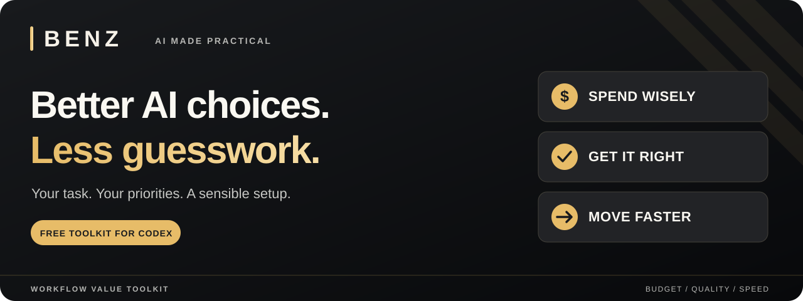

<p align="center">
  
</p>

# Workflow Value Toolkit by Benz

**Get more from the AI you already use.**

Writing a book. Planning a project. Getting an email out the door. Each job needs a different amount of care, time, and AI power.

This free toolkit helps **Codex recommend the right AI settings for your task**. Tell it what matters most: keeping costs down, getting a polished result, or finishing sooner. It weighs the options and explains its recommendation.

You stay in control. Recommendations only become setting changes when your app supports that change and you have authorized it.

**[Get the free toolkit →](https://github.com/Benz4000/workflow-value-toolkit/releases/latest)** &nbsp; · &nbsp; [Simple setup guide](INSTALL.md)

*Made for Codex. Free to download and reuse under the MIT license. Your usual AI service charges still apply.*

## Put your budget where it matters

The biggest AI option can be more than a simple job needs. A cheaper option can also cost you time if you have to keep fixing the result.

The toolkit looks for the sweet spot: enough capability to do the job well, with a reason for every step up in cost or speed.

| What matters to you | How it helps |
|---|---|
| **“Make my budget go further.”** | Looks for a sensible setup that meets your needs, including the cost of retries and corrections. |
| **“This needs to be good.”** | Gives quality more weight when the result needs extra care. |
| **“I need this soon.”** | Checks whether paying for faster AI could actually help you finish sooner. |

The default is **cost first, quality second, speed third**. The standard you need still matters in every mode.

## Everyday jobs. Different priorities.

These are examples of how to ask for advice about your setup:

| You're working on… | Tell Codex… |
|---|---|
| A short customer email | “Keep this economical. It needs to be clear and friendly.” |
| The final review of your book | “Quality comes first. Help me choose a setup for a careful review.” |
| Product descriptions due this afternoon | “Time matters today. Help me balance speed with cost.” |
| A project that just became more complicated | “The job has changed. Check whether the current setup still makes sense.” |

## Try it on your next task

After [installing the toolkit](INSTALL.md), paste this into a new Codex chat:

```text
$workflow-check
I'm writing a short email to a customer.
Recommend a sensible AI setup. Keep costs down while making it clear and polished.
Explain your choice in plain English.
```

Then describe your own job in place of the email. You can ask for more care, a lower cost, or a quicker result using ordinary language.

You don't need to memorize the commands. You can also choose **workflow-check** from Codex's skill picker. A “skill” is simply a reusable set of instructions that helps Codex handle a particular job.

## Eight tools, one sensible starting point

Start with the main check. The other tools are there when you want more control.

| Included | What it gives you |
|---|---|
| **One everyday check** | A recommendation for which AI to use, how much thinking the job needs, and whether extra speed is worth considering. |
| **Six priority presets** | Every order of cost, quality, and speed. Pick what matters most, then what comes next. |
| **One optional change-of-plan check** | As you chat, notices meaningful changes to the job and can suggest a fresh look at the setup. |

<details>
<summary><strong>See all six priority shortcuts</strong></summary>

| Your order | Paste into Codex |
|---|---|
| Cost → quality → speed | `$workflow-cost-quality-speed` |
| Cost → speed → quality | `$workflow-cost-speed-quality` |
| Quality → cost → speed | `$workflow-quality-cost-speed` |
| Quality → speed → cost | `$workflow-quality-speed-cost` |
| Speed → cost → quality | `$workflow-speed-cost-quality` |
| Speed → quality → cost | `$workflow-speed-quality-cost` |

Use `$workflow-check reset` to return to the default. Your choice applies to the current task until you change it.

</details>

## Plans change. Your setup can be reconsidered.

An outline becomes a finished book. A quick draft becomes something a client will see. A relaxed deadline moves to today.

Turn on the optional change-of-plan check when you want help noticing those shifts:

```text
$workflow-direction-check on
```

It checks during your conversation and stays quiet when nothing meaningful changes. It does nothing while the chat is idle. It starts off and is only enabled when you ask for it in that chat.

Use `off` to stop it, `once` for a single check, or `status` to see the remembered setting. Like other AI instructions, it uses some context and reasoning; it is designed to keep that overhead small.

## A few things to know

- **You need Codex with plugin support.** This is an add-on for Codex, not a standalone app or a general ChatGPT extension.
- **The download is free.** Your Codex subscription, credits, and usage charges are separate.
- **It recommends settings.** It cannot unlock paid models, add speed options to your account, or switch settings just by naming them.
- **Results depend on the job.** The aim is better value; there is no guaranteed saving or universal best setting.
- **Your preferences stay yours.** Installation doesn't rewrite your global settings or turn on the optional change-of-plan check.

## Ready for less guesswork?

**[Download Workflow Value Toolkit →](https://github.com/Benz4000/workflow-value-toolkit/releases/latest)**

Choose **`workflow-value-toolkit-1.0.0.zip`**, then follow the [setup guide](INSTALL.md). Start with one ordinary task and tell Codex what matters to you.

---

**Built by [Benz](https://github.com/Benz4000). AI made practical.**

[Detailed guide](workflow-value-toolkit/README.md) · [AI model selection explained](workflow-value-toolkit/skills/workflow-check/references/selection-guide.md) · [Get help or suggest an improvement](https://github.com/Benz4000/workflow-value-toolkit/issues) · [MIT license](LICENSE)

Independent project. Not affiliated with OpenAI.
